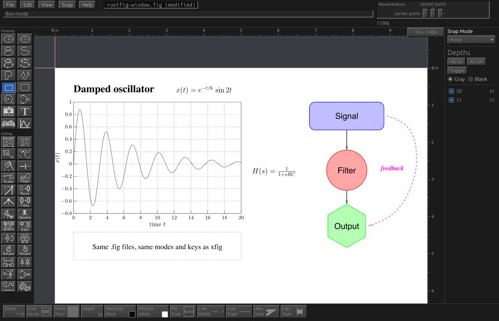

# RustFig

**xfig for today's computers.** The classic vector drawing program, rebuilt
in Rust for macOS, Windows, Linux and the web, with fig2dev built in.

[](https://github.com/FabianHassler/rustfig/actions/workflows/ci.yml)
[](#license)




- **It is xfig.** The same modes, mouse buttons, panels and keys, and the
  same `.fig` files: RustFig opens every Fig version and saves Fig 3.2 that
  xfig and fig2dev read unchanged.
- **It runs everywhere.** Native on macOS, Windows and Linux, no X11
  needed; a web build for the browser is in testing.
- **LaTeX on the canvas.** Special text is typeset by your TeX installation
  and shown as it will print, formulas included; plots of functions and
  data with LaTeX labels.
- **Every fig2dev export, built in.** PDF, SVG, EPS, PNG, pstex/pdftex,
  TikZ, PSTricks, pict2e and all of fig2dev's other languages, through
  fig2dev's drivers ported to Rust. The `fig2dev` command line comes along.
- **Modern where it helps.** Native printing, undo, command search
  (⌘⇧K / Ctrl+Shift+K), F1 help everywhere, the system's keys next to
  xfig's, and automation through a JSON control channel and MCP.

**[Download RustFig](https://github.com/FabianHassler/rustfig/releases)**
for macOS, Windows or Linux, or install it with Homebrew; see
[Installation](#installation). Or **[try it in your browser](https://fabianhassler.github.io/rustfig/)**,
nothing to install (a preview: drawings stay in your browser until you save
them as a download, and a few exports need the desktop app). The drawing above is
[`docs/images/rustfig-window.fig`](docs/images/rustfig-window.fig).

## Installation

### Download the app

Each release on the [Releases page](https://github.com/FabianHassler/rustfig/releases)
has ready-made apps (not yet signed by Apple or Microsoft):

| System | File | How |
|--------|------|-----|
| macOS (Apple silicon) | `RustFig-VERSION-macos.dmg` | Drag RustFig to Applications. The app is not notarized by Apple yet, so the first start is refused: open System Settings > Privacy & Security and click **Open Anyway** (or run `xattr -dr com.apple.quarantine /Applications/RustFig.app` once). `.fig` files then open with a double-click. |
| Windows | `rustfig-VERSION-windows.zip` | Unpack anywhere and start `rustfig.exe`. `fig-association.reg` makes `.fig` files open in RustFig. |
| Linux (x86-64 and ARM64) | `.deb` or `.tar.gz` | `sudo apt install ./rustfig_VERSION_amd64.deb` (`_arm64.deb` on ARM, e.g. a Linux VM on an Apple-silicon Mac), or unpack the `.tar.gz` and run `install.sh`; both register the `.fig` file type. The `.deb` leaves the name `fig2dev` to Debian's fig2dev package: run RustFig's as `rustfig fig2dev …`. |

### Homebrew (macOS, Linux)

The tap [FabianHassler/homebrew-tap](https://github.com/FabianHassler/homebrew-tap)
builds `rustfig` and `rustfig-cli` from source (`rustfig fig2dev …` runs
fig2dev's command line); `fig2dev-rs` adds a plain `fig2dev` command.

```sh
brew install fabianhassler/tap/rustfig
brew install fabianhassler/tap/fig2dev-rs    # optional: `fig2dev`
```

Update with `brew upgrade rustfig`, remove with
`brew uninstall rustfig`. Homebrew's own `fig2dev` formula (the C program)
installs the same command name as `fig2dev-rs`: keep one of them linked.

### From source (Cargo)

1. **Rust 1.92 or newer** from [rustup](https://rustup.rs) (`rustup update`
   brings an older one up to date).
2. **Linux only:** the libraries the window system needs, e.g. on
   Debian/Ubuntu:

   ```sh
   sudo apt install pkg-config libgtk-3-dev libxkbcommon-dev libwayland-dev \
     libxcb-render0-dev libxcb-shape0-dev libxcb-xfixes0-dev
   ```

   macOS and Windows need nothing extra.
3. **Install** both programs (`rustfig`, the drawing program, and
   `rustfig-cli`, the command line):

   ```sh
   git clone https://github.com/FabianHassler/rustfig
   cd rustfig
   cargo install --locked --path apps/rustfig
   cargo install --locked --path apps/cli
   ```

   Or install straight from GitHub, without a clone:

   ```sh
   cargo install --locked --git https://github.com/FabianHassler/rustfig rustfig rustfig-cli
   ```

   (add `--branch`, `--tag` or `--rev` to pick a version; the default is the
   latest `main`).

   Cargo fetches fig2dev, the converter RustFig exports through, from its own public
   repository ([FabianHassler/fig2dev](https://github.com/FabianHassler/fig2dev))
   by itself.

The programs go into `~/.cargo/bin` (Windows: `%USERPROFILE%\.cargo\bin`),
which rustup puts on your `PATH`. Update later with `git pull` and the same
two `cargo install` lines (or rerun the `--git` line with `--force`); remove with `cargo uninstall rustfig rustfig-cli`.

## Getting started

```sh
rustfig drawing.fig                         # draw
rustfig-cli convert drawing.fig drawing.pdf # convert without opening a window
rustfig-cli formats                         # list the export languages
rustfig-cli mcp                             # MCP server for AI assistants
```

Tool shortcuts follow xfig: `C` circle, `E` ellipse, `L` polyline,
`P` polygon, `B` box, `I` spline, `R` arc, `T` text, `M` move, `D` delete,
`S` select. Left click adds points; double click, right click or Enter
finishes; Esc cancels. Without a three-button mouse: Option/Alt + click is the
middle button, and on macOS Ctrl + click the right one (on Linux and Windows,
left and right pressed together also give the middle button).

Fonts: RustFig draws text with the fonts installed on your system (Times,
Helvetica, Courier, Symbol, Palatino, … or their URW/TeX Gyre clones) and
falls back to built-in fonts. Help > Install TeX Gyre fonts… downloads the
metric-compatible TeX Gyre fonts from CTAN (checked by SHA-256, nothing is
bundled). `FIG2DEV_BUILTIN_FONTS=1` forces the built-in fonts.

## What RustFig can do

**Beta (pre-releases 0.9.0-beta.N). Overall xfig parity ≈93 %** (see [ROADMAP.md](ROADMAP.md) and the
[parity assessment](docs/target-app-parity.md)).

- Draw: circles, ellipses, approximated/interpolated/X-splines, polylines,
  polygons, boxes, rounded boxes, regular polygons, arcs, text, pictures.
- Edit (xfig's modes, no selection layer): move, copy, delete, scale, rotate,
  flip, edit attributes with live panels, update, add/move/delete points,
  glue/break/open compounds, join/split, chop, trim/split/extend, align,
  convert, open/close, arrows, tangent/normal, measure, multi-level undo.
- Settings: preferences, xfig's command line, styles with families, colours
  (picker, user colours, pick from screen).
- Files: reads Fig 1.3–3.2, writes Fig 3.2 and a native JSON format.
- Export (every format through fig2dev's drivers, ported to Rust): PDF, SVG, EPS, PNG, GIF, JPEG, TIFF, PPM, PCX, XBM, XPM, LaTeX box (all 22 xfig fill patterns, arrowheads and dashes as fig2dev draws them); from fig2dev's ported drivers LaTeX picture, epic/eepic/eepicemu, PiCTeX, TeXtyl, tpic, pic, pstex/pdftex, pict2e, CGM, HPGL, DXF, MetaPost, METAFONT, ge, image map, Gerber, shape, TikZ, PSTricks, EMF, Tk/Perl-Tk and AutoCAD slides (every fig2dev language).
- Automation: every action is a command, reachable from a JSON control
  channel, an MCP server and the command line.

## fig2dev

RustFig includes [fig2dev](https://github.com/FabianHassler/fig2dev), xfig's
converter, ported to Rust: the same command line, options, messages and exit
codes as fig2dev 3.2.9a, without ghostscript or other helper programs. Use it
three ways:

```sh
rustfig fig2dev -L pdf drawing.fig drawing.pdf     # through the rustfig program
rustfig-cli fig2dev -L eps drawing.fig drawing.eps # or rustfig-cli
fig2dev -L svg drawing.fig drawing.svg             # under its own name (see below)
```

Common uses (all of fig2dev's options are accepted; `rustfig fig2dev -h` lists
them, `-h` after `-L LANG` shows the language's own options):

```sh
rustfig fig2dev -L pdf -m 0.5 in.fig out.pdf        # half size
rustfig fig2dev -L png -m 2 -S 4 in.fig out.png     # bitmap, double size, smoothed
rustfig fig2dev -L pdftex in.fig out.pdf            # graphics for LaTeX ...
rustfig fig2dev -L pdftex_t -p out.pdf in.fig out.pdf_t   # ... and the text part
rustfig fig2dev -L tikz in.fig out.tex              # TikZ picture
rustfig fig2dev -L eps -D +10,20 in.fig out.eps     # only depths 10 and 20
cat in.fig | rustfig fig2dev -L svg > out.svg       # stdin to stdout
```

Languages: PostScript, EPS, PDF, SVG, PNG, GIF, JPEG, TIFF, PPM, PCX, XBM,
XPM, LaTeX picture, epic, eepic, eepicemu, PiCTeX, TeXtyl, tpic, pic,
pstex/pdftex/pspdftex, pict2e, TikZ, PSTricks, LaTeX box, CGM, HPGL, DXF,
MetaPost, METAFONT, ge, image map, Gerber, shape, EMF, Tk, Perl-Tk and
AutoCAD slides (`sld`).

**As `fig2dev` for old scripts and Makefiles:** the `rustfig` program behaves
as fig2dev when it is started under that name, so a link is enough:

```sh
ln -s ~/.cargo/bin/rustfig ~/.local/bin/fig2dev   # any directory on PATH
```

On Windows copy `rustfig-cli.exe` to `fig2dev.exe` instead (the GUI program
has no console window for messages). If the C fig2dev is installed too, the one
that comes first on `PATH` runs (`which -a fig2dev` shows both). fig2dev can
also be installed on its own, without RustFig: see
[its README](https://github.com/FabianHassler/fig2dev#installation).

**Pictures inside figures:** PDF pictures stay vectors in PDF, PostScript and
EPS output. EPS pictures are copied into PostScript/EPS output; for PDF and
bitmap output they need ghostscript (`gs`) installed, otherwise their preview
image is used.

## Aim: xfig, kept as it is

RustFig keeps what makes xfig good: its **simplicity** and its **full
functionality**. Every xfig mode, button and option stays, and works the way
xfig users expect.

Additions must respect xfig. They fit into xfig's way of working (its modes,
its three mouse buttons, its panels) and don't change what an existing xfig
action does. Departing from xfig needs a good reason, for example printing,
which no longer works the old way on today's systems. A modern look is fine;
a different program is not.

The Fig file format stays **fully backward compatible**. RustFig reads every
Fig version xfig reads and saves Fig 3.2 that xfig and fig2dev open
unchanged. A feature RustFig adds must fit inside the format (for example in
an object's comment, with a plain Fig fallback), never extend or break it.

## Development

From the source tree without installing:
`cargo run --release -p rustfig -- drawing.fig`. `cargo xtask ci` runs the
quality gates (format, lints, tests, layering, asset and licence checks, the
web build); `cargo xtask package` builds the app bundle for your system;
`cargo xtask web` builds the web version. See [Development](docs/development.md)
and [Architecture](docs/architecture.md).

## Documentation

[Architecture](docs/architecture.md) · [Development](docs/development.md) ·
[MCP](docs/mcp.md) · [Gaps](docs/gaps.md) · [Milestones](docs/roadmap.md)

## License

Code is licensed under MIT OR Apache-2.0 (`LICENSE-MIT`, `LICENSE-APACHE`). Parts ported from xfig and fig2dev also carry the xfig licence notice (`LICENSE-xfig`).
See `NOTICE` and `ASSETS.md`.
