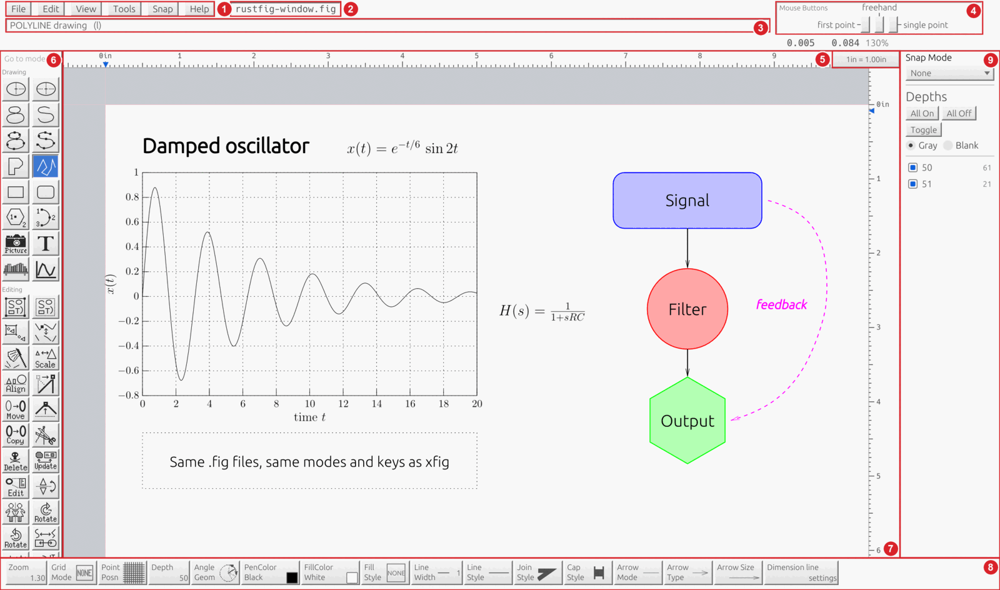

# Getting started

## The window

Modes are chosen in the mode panel on the left (6), you draw on the canvas (7), the attributes of new objects are in the indicator panel at the bottom (8), and the mouse indicator at the top right (4) says what each mouse button does right now. [The window](window.md) explains every area.

## Watch a figure being drawn

The movie (about a minute and a half, captions switchable) starts with a tour of the window, then draws a block on an inclined plane with the mouse: the slope in Polygon mode, the angle in Measure angle mode (the middle button keeps it as the rotation angle, Shift+middle draws it), the block as a box rotated onto the slope, the forces as lines with arrows, LaTeX labels, a copy taken back with Undo, then Save and File › Export to PDF. A ring marks each click, and the pressed button lights up in the mouse indicator. On a Mac, Option+click is the middle button and Ctrl+click the right one.

## Your first figure

1. Pick a mode from the mode panel on the left, for example **Box** (key `B`). The message panel at the top says what to do next, and the mouse indicator shows what each mouse button does right now.
2. Press the left button on the canvas, drag, and release. The box is drawn with the current attributes shown in the indicator panel at the bottom (line width, colors, fill and so on).
3. Pick **Move** (key `M`), click the box and click again where it should go. xfig has no selection: a mode acts on the object you click.
4. Change how things look: set an attribute in the indicator panel, then use **Update** (key `U`) on an object, or pick **Edit** (the Edit mode button; Ctrl+E with xfig's keys) and click an object to open its edit panel.
<!-- os: mac -->
5. Press Cmd+Z to undo (Option+U too, when "xfig keyboard shortcuts in menus" is on in Edit > Global settings). RustFig keeps many undo levels.
<!-- os: linux windows -->
5. Press Ctrl+Z to undo (Alt+U is xfig's key; turn on "xfig keyboard shortcuts in menus" in Edit > Global settings to use it). RustFig keeps many undo levels.
<!-- os: end -->
6. File > Save As writes a `.fig` file. File > Export writes PDF, SVG, EPS, PNG and other formats.

## Things worth knowing early

- Most modes have three mouse button functions. See [The mouse](mouse.md) for how to press the middle and right buttons without a three-button mouse.
- Hold Shift to see Shift variants in the mouse indicator.
- Press Escape or the right button to cancel what you are doing in most modes. Escape again clears what the mode has collected, and once more leaves the mode. While drawing a line, Backspace removes the last point.
- Coordinates are in 1/1200 inch (Fig units); you work in inches or centimeters as the units box says.
- The figure is never lost when the program stops unexpectedly: see [Files](files.md) (recovery).

## Example drawings

RustFig's repository has a folder of example drawings to open and take apart: <https://github.com/FabianHassler/rustfig/tree/main/examples>.

- **Science gallery** (`examples/gallery/`): sixteen drawings from mathematics and physics (Carnot cycle, double slit, Feynman diagram, RLC circuit, Minkowski diagram and more), with all text in LaTeX. They show how to set up a figure whose labels LaTeX typesets: turn on View > Typeset LaTeX Text to see them typeset on the canvas, and export with File > Export, language "Combined PDF/LaTeX (both parts)".
- **Generated drawings**: a Clifford attractor (250,000 dots), an Apollonian gasket, a Penrose tiling and a Gosper curve.
- **Maps and pictures** imported from SVG: world maps, a topographic map of Greece, landscapes.

Open them with File > Open: the compressed `.fig.gz` files open directly.
