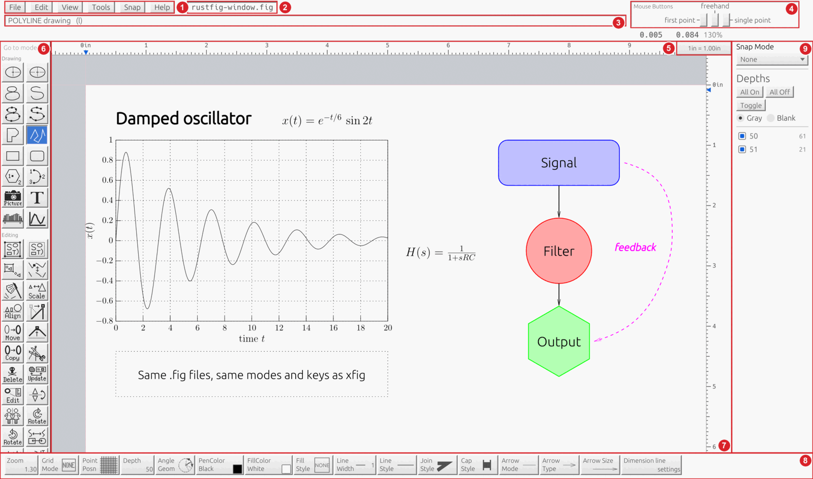

# The window

RustFig keeps xfig's arrangement of the main window.

| | Area | What it is for |
|---|---|---|
| 1 | Menus | File, Edit, View, Tools, Snap, Help |
| 2 | File name | the current file; click to rename |
| 3 | Message panel | what to do next, errors, information |
| 4 | Mouse indicator | what each mouse button does right now |
| 5 | Units box | inches or centimeters and the scale |
| 6 | Mode panel | the modes: drawing first, then editing |
| 7 | Canvas and rulers | the drawing area |
| 8 | Indicator panel | the attributes of new objects and the current mode |
| 9 | Depth manager | depths shown or hidden, the Snap Mode box above it |

Each area is described below.

## Top strip

- **Menus**: File, Edit, View, Tools (RustFig's own, after View: finding objects and modes, importing pictures, plots), Snap and Help. The entries of each menu are grouped under small section titles. See [Menus](menus.md).
- **File name**: the current file; it is marked when there are unsaved changes. Click it to rename the file.
- **Message panel**: what to do next, errors and information. Click it to see the history of messages (also Help > Message history..., `app.messages`).
  - Each message has a level: information, warning (for example the notes after opening a file) or error (red). The window's **Info**, **Warning** and **Error** check boxes choose which levels are listed, **Copy** puts the listed messages on the clipboard one per line (warnings and errors start with their level), **Clear** empties the history and **Dismiss** (or Return) closes the window, as in xfig. Scripts use `app.messages` and `app.copy_messages` with `levels`, for example `["warning","error"]`.
- **Mouse indicator**: three boxes, one per mouse button, say what each does in the current mode and step. Hold Shift to see the Shift meanings. Hovering shows the same as text. See [The mouse](mouse.md) for examples.
- **Units box**: shows the units (inches or centimeters, a scale); a left click pans to the origin, a right click opens the Unit/Scale panel (Edit > Set units).

## Mode panel (left)

One button per mode: drawing modes first, then editing modes. Hover for the name and key. The same modes are available as keys, see [Keys](keys.md). The mode is highlighted while it is active. On a small screen the panel scrolls vertically (mouse wheel over it); the buttons keep their size.

At the top of the panel, which stays in place while the buttons scroll, is the **Go to mode** field. Type part of a mode's name (upper or lower case; the name and xfig's long text are searched, so `arr` finds Add/remove arrows) and a short list shows the matches with each mode's icon at the left and its key at the right, to learn them. Up and Down move in the list (pointing at a row with the mouse moves there too), Return or a click picks the mode exactly as its button does, Escape clears the field. Ctrl+J (⌘ J on macOS; Tools › Go to mode…) puts the caret in the field from anywhere.

Below it, the **Favorites** strip holds up to eight small mode buttons of your own choice; it is hidden while empty. Right-click a mode button and choose Add to favorites (or Remove from favorites); a click on a favorite selects the mode like the panel button, and the same button shows as active. The favorites are kept in the settings file (`[rustfig] mode_favourites`). Scripts use `mode.favourite` and `mode.favourites`.

## Start screen

Help › About RustFig shows a card with RustFig's name, version, copyright, license and xfig's copyrights, until you click or press a key. RustFig starts straight into the window; to see the card for three seconds at every start, as xfig shows its splash graphic, start with `-splash` or turn on the `splash` setting in Global settings (the first key or click fades it out and still does its job). Scripts can show it with the `app.splash` command (Show Start Screen).

## Canvas

The drawing area with the page (page borders can be shown or hidden, View menu) and optional grid. Rulers at the top and left show the position; the scale follows the zoom. Scroll or use the rulers' arrows to pan; Z and Shift+Z zoom (see [Zoom and view](view.md)).

## Indicator panel (bottom)

Buttons for the attributes that new objects get and that the current mode needs: line width, line style, colors, fill, arrows, font and so on. Which buttons show depends on the mode, as in xfig. See [The indicator panel](attributes.md).

## Depth manager (right, optional)

Lists the depths in use with check boxes to show or hide them (View > Show depth manager).

Choosing a mode puts xfig's sentence for it, with its key, in the message panel (for example “Rectangular BOX drawing   (b)”). After opening a file the message reads `Current figure "name" (N objects)`. RustFig's own Trim button is the last of the editing buttons, so every xfig button keeps its place in the grid.

## Dialogs

A dialog taller than the window (Global settings on a small screen, for example) gets a vertical scroll bar: scroll with the mouse wheel or drag the bar to reach the rows and buttons below.
