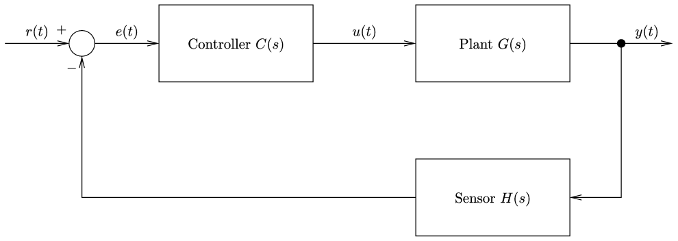
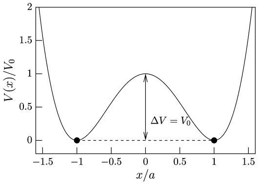
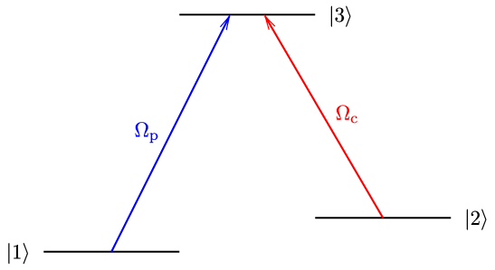

# Figures drawn by an AI assistant

Each figure was drawn from the one-sentence prompt above it, by an assistant using RustFig's MCP server (`rustfig-cli mcp`) and the [RustFig skill](../../skills/rustfig/SKILL.md). Each folder holds the drawing (`.fig`), its PDF (labels typeset by LaTeX), the preview the assistant looked at (`.png`) and `prompt.json`: the prompt and every command the assistant ran, in order.

How to set it up: [AI assistants](https://fabianhassler.github.io/rustfig/manual/ai-assistants.html) in the manual.

## feedback-loop

> Draw the block diagram of a feedback loop: controller C(s), plant G(s) and a sensor H(s) in the feedback path, a summing junction with + and −, the signals r, e, u, y labeled in LaTeX. Save it as feedback-loop.fig and export a PDF.

23 commands: [`feedback-loop.fig`](feedback-loop/feedback-loop.fig), [`feedback-loop.pdf`](feedback-loop/feedback-loop.pdf), [`prompt.json`](feedback-loop/prompt.json).

## double-well

> Plot the double-well potential V(x) = V0 (x²/a² − 1)² for x/a from −1.6 to 1.6 with LaTeX axis labels, mark the two minima and the barrier height ΔV = V0.

9 commands: [`double-well.fig`](double-well/double-well.fig), [`double-well.pdf`](double-well/double-well.pdf), [`prompt.json`](double-well/prompt.json).

## lambda-system

> Draw the energy-level diagram of a three-level Λ system: ground states |1⟩ and |2⟩, excited state |3⟩, the probe Ω_p (blue) from |1⟩ and the coupling Ω_c (red) from |2⟩, labels in LaTeX.

13 commands: [`lambda-system.fig`](lambda-system/lambda-system.fig), [`lambda-system.pdf`](lambda-system/lambda-system.pdf), [`prompt.json`](lambda-system/prompt.json).
